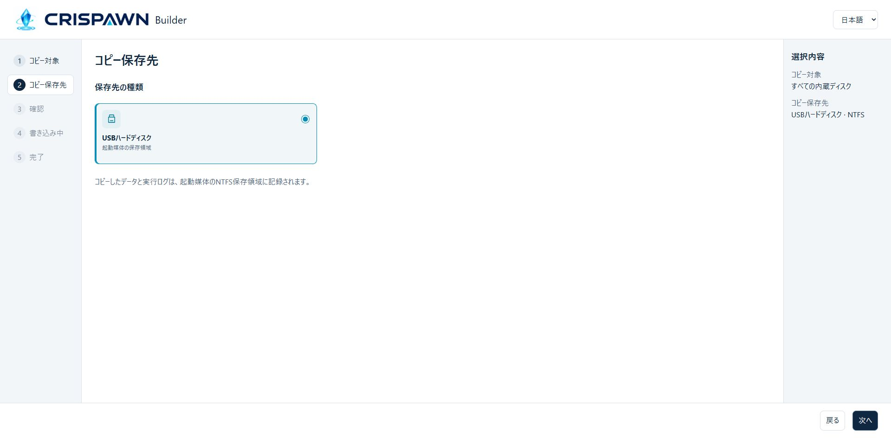

  

# CRISPAWN Builder

CRISPAWN Builderは、WindowsでCRISPAWN LiveOSの起動用USBを作るアプリです。選んだ設定をベースISOに組み込んで、新しいISOを作ることもできます。OSS版のバックアップ保存先はUSBです。

[English](README.md)

*日本語表示のコピー保存先画面。*

## 用意するもの

- Windows PCと、対応するCRISPAWN LiveOSのISO。
- USB作成には、GPT形式で**256 MiBのEFIシステムパーティション**と、ラベルが`CRISPAWN`の**NTFS保存領域**を持つ準備済みUSB。WindowsでUSBディスクとして認識される必要があります。
- 設定入りISOの作成には、ベースISOの配布元で確認したSHA-256値。

空のUSBを初期化する機能やISOのダウンロード機能はありません。このソースリポジトリにはインストーラーとLiveOSのISOを含みません。

## 起動用USBを作る

1. CRISPAWN Builderを起動します。**このPC**を選ぶと内蔵ディスクが表示されます。**他のPC**は全内蔵ディスクを対象にする汎用設定です。現行の対応ISOでは、一部のディスクだけを選んでコピーすることはできません。
2. コピー保存先が**USBハードディスク**であることを確認します。
3. **確認**画面で開始までの時間、LiveOSの言語、完了後の動作を確認します。作成するものを**起動用USB**とし、名称・容量・ディスク番号・ドライブレターを見て準備済みUSBを選びます。
4. **USBに書き込む**を押して対応ISOを選び、Windowsの確認内容を確認します。進捗画面で書き込みと読み戻し照合が終わるまでUSBを抜かないでください。
5. **完了**画面を確認してからUSBを取り外します。対象PCで起動し、バックアップ結果を確認してください。

USB上の既存NTFS保存領域は保持します。選択したUSBのISOと起動ファイルを更新し、書き込み直前にディスクの識別情報を再照合します。

## 設定入りISOを作る

1. **コピー対象**と**コピー保存先**を選びます。
2. **確認**画面の「作成するもの」を**ISOファイル**にし、配布元で確認したベースISOのSHA-256値を入力します。
3. **ISOを作成**を押し、ベースISOと新しい保存先を選びます。**完了**画面が出るまで待ちます。

ISOとともに照合用の`.sha256`と`.json`が生成されます。ISO生成はアプリ内で完結し、Python、xorriso、補助プログラムのインストールは不要です。

runtime v2のベースISOは、initramfs内の`/etc/perfect-backup/release-capabilities.json`で対応設定を宣言する必要があります。宣言ファイルがないというエラーが出た場合は、配布元から修正版のベースISOを入手してください。

OSS版のバックアップ保存先はローカルUSBです。SMB、S3、Wi-Fi設定、ドライバー組み込みには対応していません。

ソースからのビルドとテストは[BUILDING.ja.md](BUILDING.ja.md)を参照してください。コードは[Apache-2.0](LICENSE)、ロゴとスクリーンショットは[別ライセンス](assets/crispawn/LICENSE)です。
