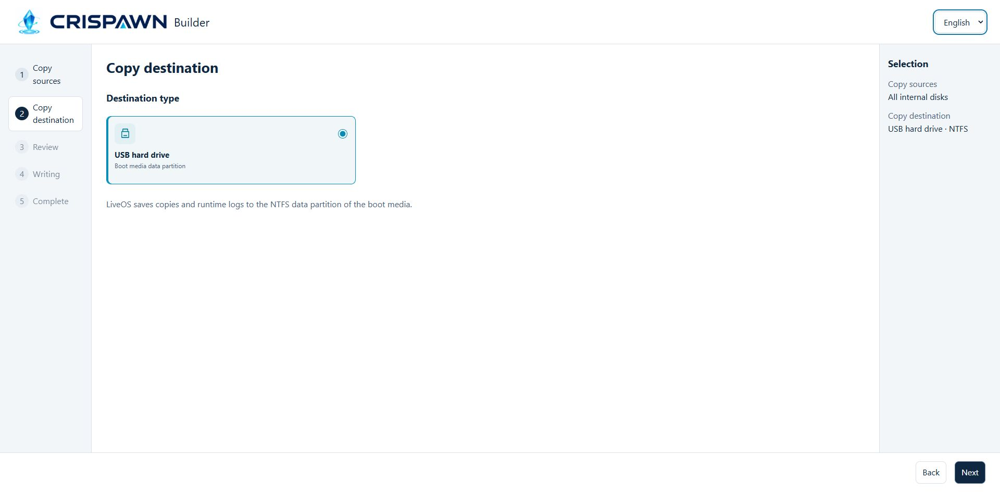

  

# CRISPAWN Builder

CRISPAWN Builder creates bootable CRISPAWN LiveOS USB drives on Windows. It can also embed your settings in a base ISO to create a new ISO. The community edition saves backups to the USB drive.

[日本語で読む](README.ja.md)

*Copy destination screen in English.*

## What you need

- A Windows PC with internet access. The Builder obtains the ISO from CRISPAWN's published GitHub releases.
- A USB flash drive, hard drive, or SSD of at least 512 MiB that Windows recognizes as a USB disk.

The Builder stores downloaded ISOs on the PC. It reuses the current release and downloads again only when a newer release appears. This source repository does not include an installer or LiveOS ISO.

## Create a bootable USB drive

1. Open CRISPAWN Builder. Choose **This PC** to see its internal disks, or **Another PC** to target every internal disk on the PC where LiveOS boots. With the currently supported ISO, you cannot copy only some disks.
2. Review the **USB hard drive** backup destination.
3. On **Review**, choose the delay before backup starts, the LiveOS language, and what happens after completion. **Backup verification** controls readback after copying; **Advanced settings** contains logging, error behavior, processing options, and timeouts. Choose **Bootable USB** and select a USB disk by its name, size, disk number, and drive letter. An unprepared disk is marked as needing initialization.
4. Click **Write USB** and review the selected disk and action. Initialization erases every partition and all data on that disk. Approve the Windows prompt and keep the USB connected until readback verification finishes.
5. When **Complete** appears, remove the USB drive. Boot it on the target PC and check the backup result.

On an already prepared CRISPAWN USB disk, the Builder retains the NTFS data partition. On an unprepared disk, it creates a GPT layout with a 256 MiB EFI System Partition and an NTFS data partition using the remaining space. It rechecks the selected USB's identity and layout before changing it.

**Skip readback verification** applies to LiveOS backup copying. It does not skip the Builder's checks when creating a bootable USB. The option is unavailable when the published ISO does not declare support for it.

## Create an ISO with settings

1. Complete **Copy sources** and **Copy destination**.
2. On **Review**, choose **ISO file** under **Output**.
3. Click **Create ISO** and choose where to save the new ISO. The Builder checks GitHub for the newest release. Wait for **Complete**.

The output includes the ISO and `.sha256` and `.json` verification files. ISO creation runs inside the application; Python, xorriso, and extra helper programs are not needed.

To create an ISO with settings from a runtime v2 base ISO, the base must include `/etc/perfect-backup/release-capabilities.json`, which declares its supported settings. If the Builder reports that this file is missing, obtain a corrected base ISO from its distributor.

The community edition supports the local USB backup destination. SMB, S3, Wi-Fi settings, and driver installation are unavailable.

For source builds and tests, see [BUILDING.md](BUILDING.md). The code is [Apache-2.0](LICENSE); the logo and screenshots have [separate asset terms](assets/crispawn/LICENSE).
